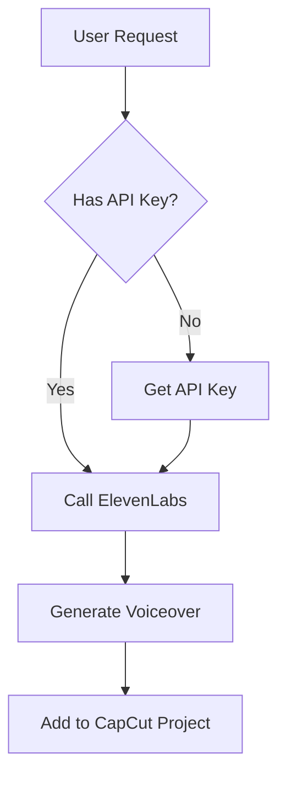
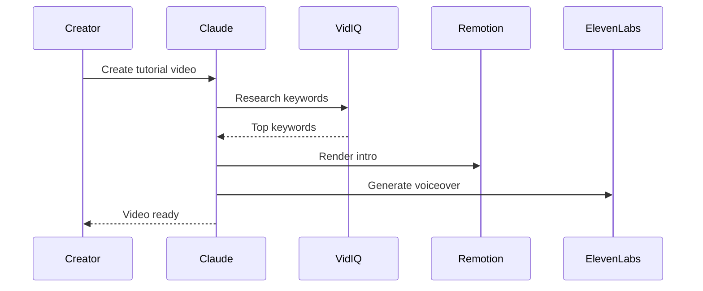
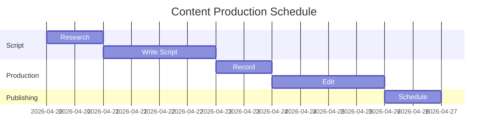
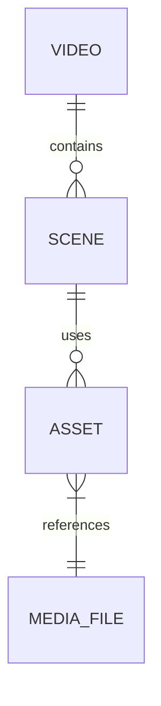
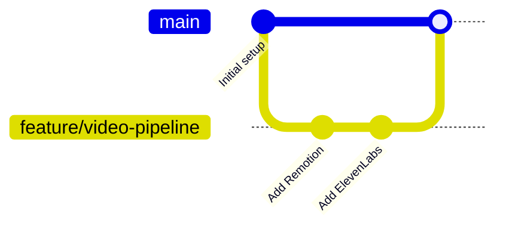

# Mermaid Diagram Skill

You are an expert in Mermaid diagram syntax. Always produce valid, complete Mermaid code.

## Render Command
```bash
mmdc -i diagram.mmd -o diagram.svg
mmdc -i diagram.mmd -o diagram.png -w 1920
```

## Diagram Types

### Flowchart


### Sequence


### Gantt Chart


### ER Diagram


### Git Graph


## Workflow
1. Write the Mermaid diagram code based on the user's request
2. Save to a `.mmd` file
3. Run `mmdc` to render
4. Display the output image
