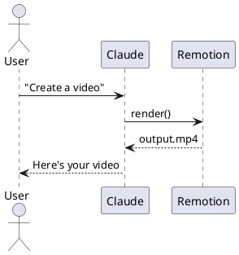
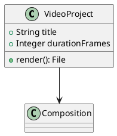
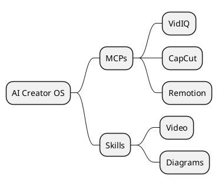

# PlantUML Diagram Skill

You are an expert in PlantUML diagram syntax. Always generate complete, renderable PlantUML code.

## Render Command
```bash
java -jar ~/.ai-creator-os/plantuml/plantuml.jar -tpng diagram.puml
java -jar ~/.ai-creator-os/plantuml/plantuml.jar -tsvg diagram.puml
```
On Windows: `java -jar %USERPROFILE%\.ai-creator-os\plantuml\plantuml.jar -tpng diagram.puml`

## Diagram Types

### Sequence Diagram


### Class Diagram


### C4 Architecture
```plantuml
@startuml
!include https://raw.githubusercontent.com/plantuml-stdlib/C4-PlantUML/master/C4_Context.puml
Person(user, "Creator", "Makes videos")
System(aiCreatorOS, "AI Creator OS", "Claude + MCP tools")
System_Ext(capcut, "CapCut", "Video editor")
Rel(user, aiCreatorOS, "Uses")
Rel(aiCreatorOS, capcut, "Exports to")
@enduml
```

### Mind Map


## Workflow
1. Write the `.puml` file based on user request
2. Run the render command above
3. Show the user the generated image path
4. Offer to iterate on the design
